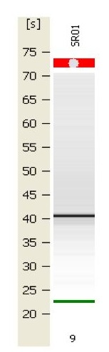

Submitted 4uL (108ng/uL) of mRNA from gigas gill (from DATE!; sometime in late August) to the Center for Array Technologies (CART) at UW. Sample was labelled "SR01".

Results:

Results were received on 20090210. Comment from CAT staff member was that it looked "pretty good." Here are links to [the gel (look for SR01)(./2100_expert_EukaryoteTotal_RNA_Nano_DE11400776_2009-02-09_12-37-49_GEL.bmp), the [electoropherogram of SR01](./2100_expert_EukaryoteTotal_RNA_Nano_DE11400776_2009-02-09_12-37-49_EGRAM_Sample9.bmp), and the [EGRAM of the ladder](./2100_expert_EukaryoteTotal_RNA_Nano_DE11400776_2009-02-09_12-37-49_EGRAM_Ladder.bmp).
