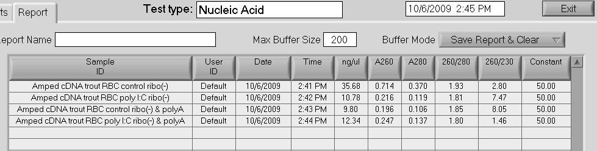
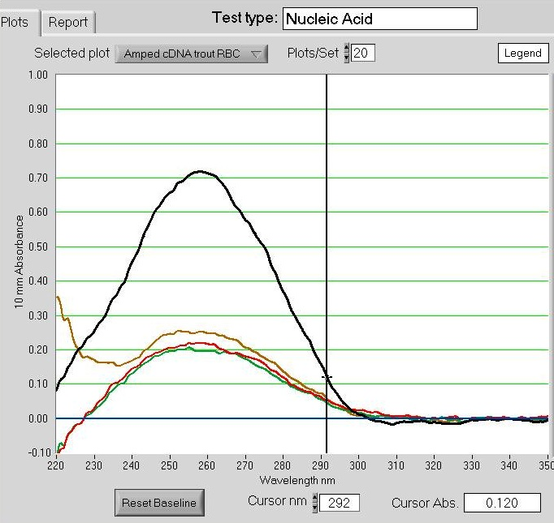

The four samples from yesterday were prepared according to the Agilent SOLiD WTK protocol. Briefly:

Results: All four samples appear to have cDNA. Interestingly, the "Amped cDNA trout RBC control ribo(-)" sample was the sample that had no detectable RNA after fragmentation, BUT this sample produced the highest yield of cDNA... See below.

1.5uL of each sample was transferred to a 0.5mL snap cap tube and stored @ -80C in the "Samples for Bioanalyzer" box for submission on the DNA 1000 Chip.

The Yellow/Brown plot above is the "Amped cDNA trout RBC poly I:C ribo(-) & polyA" sample and exhibits a strange profile at the 220-230nm range that differs than the three other samples.
