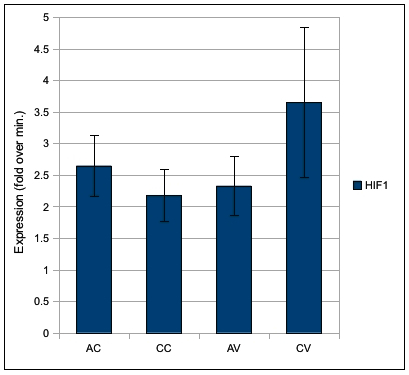
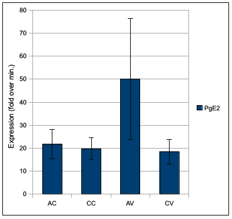

Set up qPCR with Cg_HIF1 (hypoxia induced factor 1) primers and prostaglandin E2 primers. [Plate layout/setup is here](./20091012-01.jpg).

Results: Processed with PCR Miner. Normalized to EF1. Standard Error bars. Here is spreadsheet with workup.

**HIF1**:

No significant differences between any treatments.

**Prostaglandin E2**:

No significant differences between any treatments.
