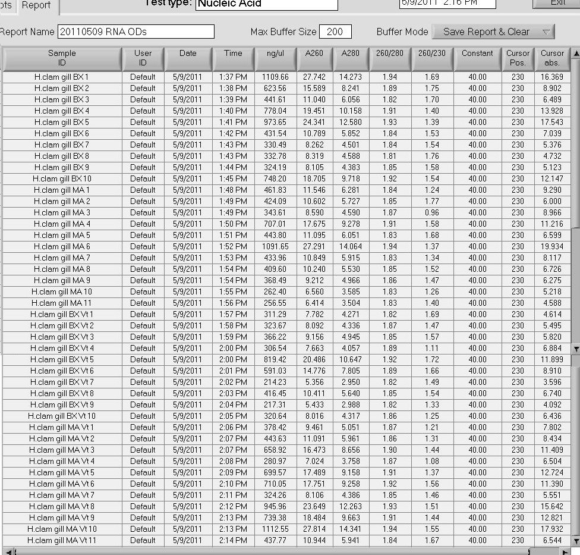

Isolated RNA in 1mL of Tri-Reagent according to the manufacturer's protocol. Also, finished RNA isolation of samples that were started 20110506. Samples were resuspended in 50uL 0.1%DEPC-H2O and spec'd.

Results:

