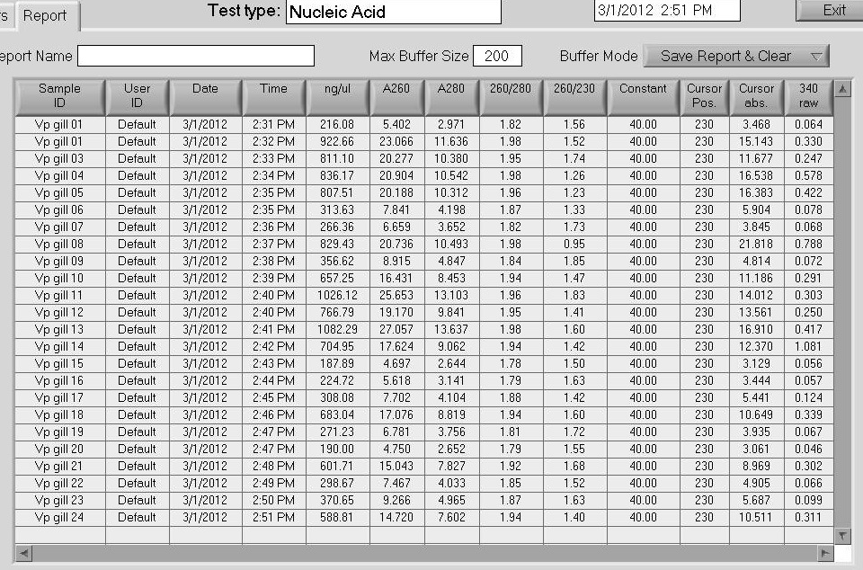

Isolated RNA from Manila Clam gill samples provided by Dave according to protocol. Samples were resuspended in 0.1%-DEPC H2O and spec'd on the Roberts Lab NanoDrop1000. Samples were stored @ -80C in Dave's box that the tissue was initially stored in.

Results:

Overall, RNA quality is very good, as well as yields.
