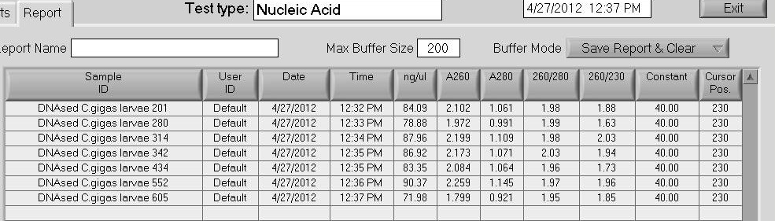

Treated 5ug of total RNA (in a 50uL rxn) using Turbo DNA-free (Ambion) according to the "Standard" protocol. Samples were spec'd on the Roberts Lab NanoDrop 1000.

Results:

All samples look good, both quality and quantity-wise. Will check for residual gDNA in these samples via qPCR.
