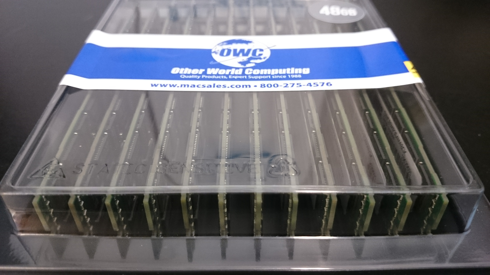
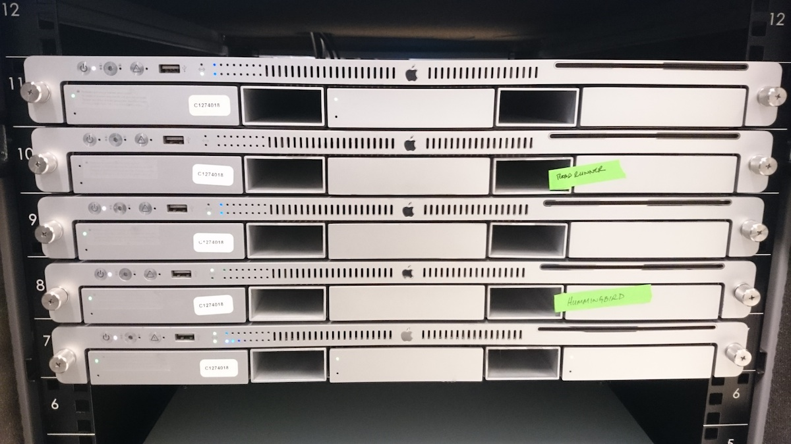
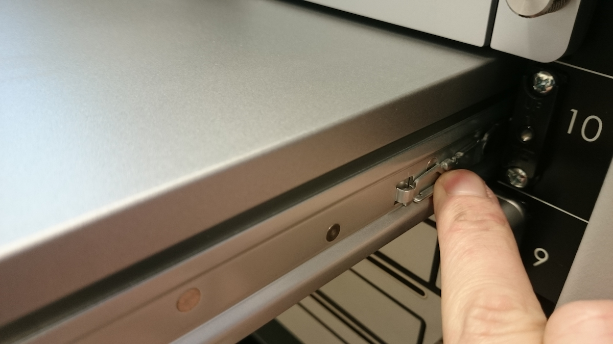
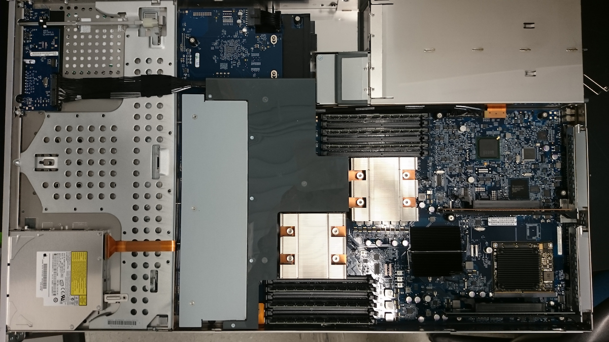
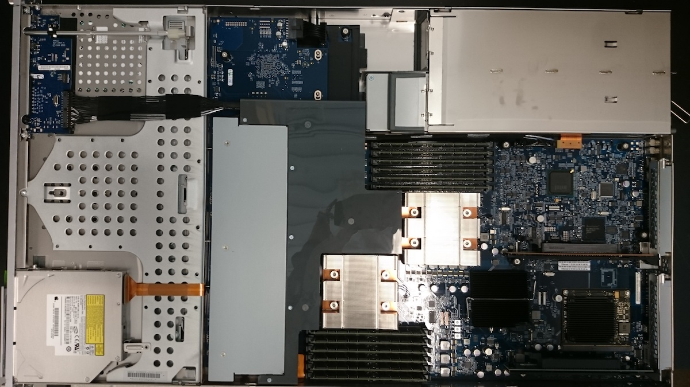
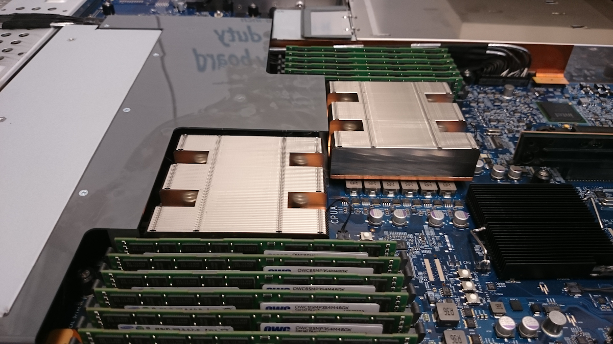
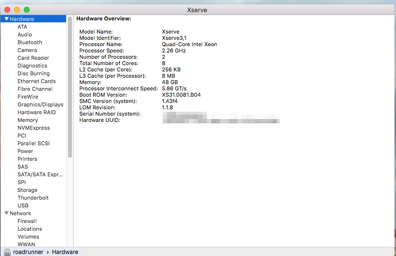

We received the new 48GB RAM set we ordered from Other World Computing for [the Apple Xserve (roadrunner) that I installed El Capitan (OS X 10.11.5) on two weeks ago](https://robertslab.github.io/sams-notebook/posts/2016/2016-05-31-computer-setup-cluster-node003-conversion/).

I installed it and this computer (which was plenty quick before) is extremely responsive now!

Below are some pics from the installation:

(./20160609_RAM_48GB.jpg)

(./20160609_xserve_cluster.jpg)

(./20160609_xserve_clip.jpg)

(./20160609_xserve_inside_old_RAM_01.jpg)

(./20160609_xserve_inside_new_RAM_01.jpg)

(./20160609_xserve_inside_new_RAM_02.jpg)

(./20160609_roadrunner_screen.jpg)
