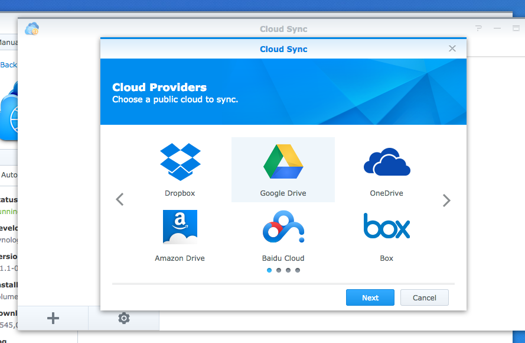
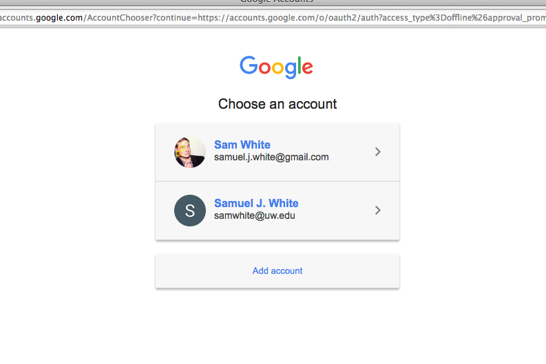
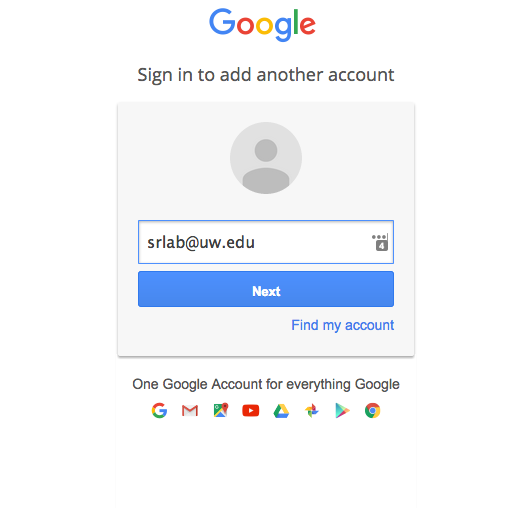
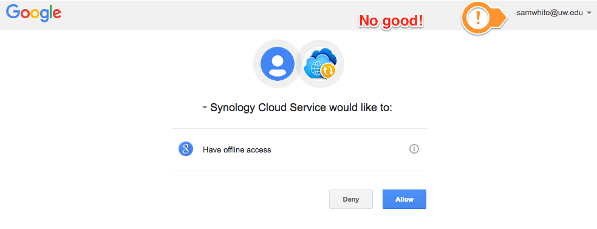
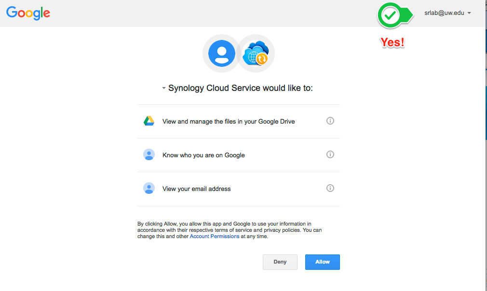
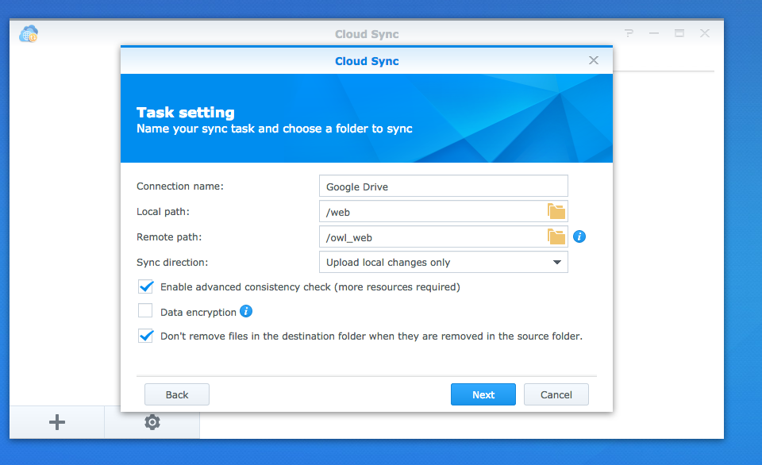
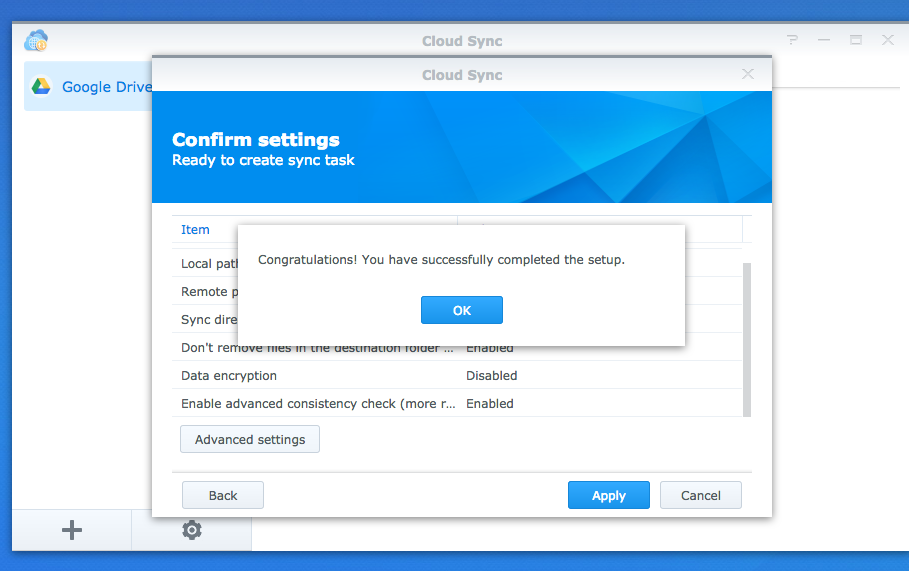
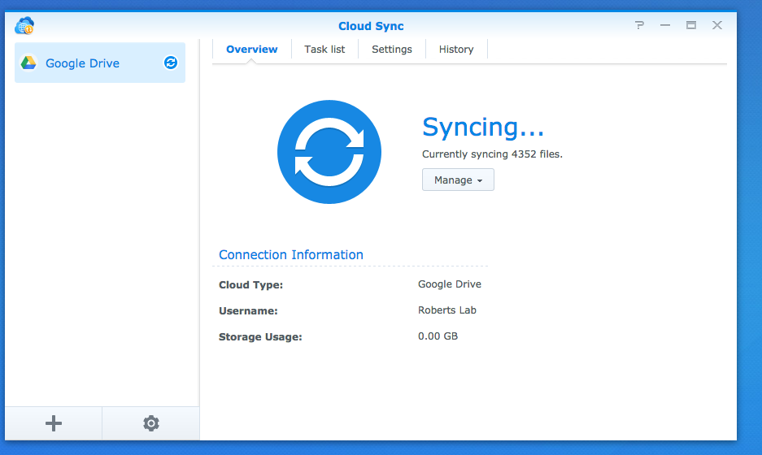
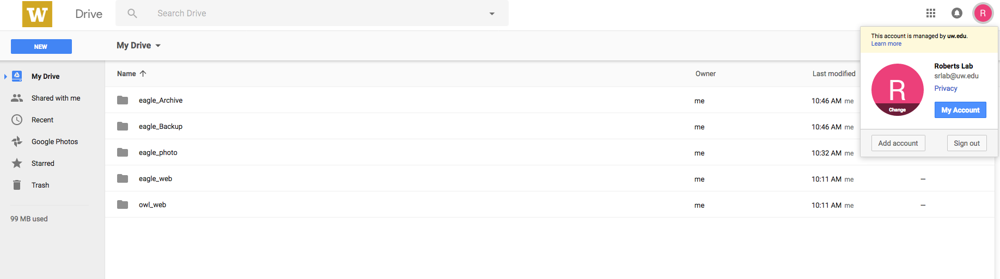

Re-examining our backup options for our two Synology servers (Eagle & Owl), I realized that they were both backing up to the just my account on UW's unlimited Google Drive storage.

The desired backup was to go to our shared UW account, so that others in the lab would have access to the backups.

Strangely, I could not add the shared UW account (srlab) to my list of Google accounts. In order to verify the shared UW account with Google, I had to connect to the servers' web interfaces in a private browsing session and then I was able to provide the correct user account info/permissions.

Anyway, it's all going to our shared UW account now.

## SELECT GOOGLE DRIVE AS THE SYNC PROVIDER:

(./Screenshot_2016-11-07_09.52.08.png)

## SHARED UW ACCOUNT IS NOT A CHOICE:

(./Screenshot_2016-11-07_09.52.33.png)

## TRY "ADD ACCOUNT":

(./Screenshot_2016-11-07_09.52.46.png)

## BUT ADD ACCOUNT DOESN'T WORK (DROP-DOWN MENU DOESN'T OFFER SRLAB AS A CHOICE)"

(./Screenshot_2016-11-07_09.53.11.png)

## REPEAT STEPS, BUT CONNECT TO SYNOLOGY VIA PRIVATE BROWSING SESSION AND IT'S GOOD TO GO:

(./Screenshot_2016-11-07_10_05_25.png)

## SET LOCAL AND REMOTE FOLDERS:

(./Screenshot_2016-11-07_10.13.44.png)

## CONFIRMATION THAT IT'S SET UP:

(./Screenshot_2016-11-07_10.07.15.png)

## AND, IT'S RUNNING:

(./Screenshot_2016-11-07_10.07.40.png)

(./Screenshot_2016-11-07_14.05.10.png)
