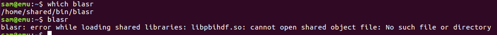
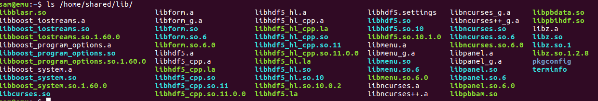
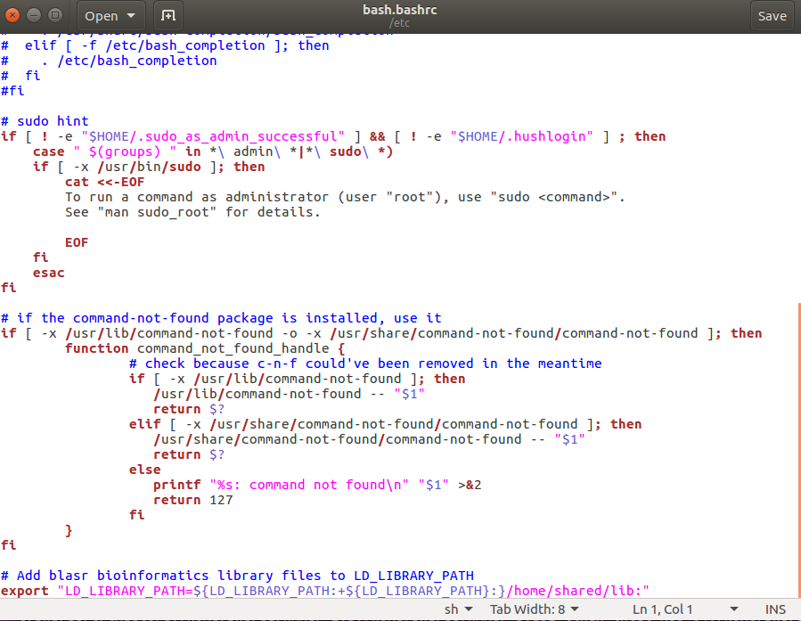
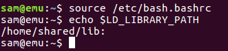
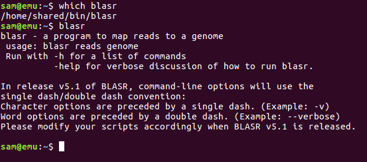

The [last "fix"](https://robertslab.github.io/sams-notebook/posts/2017/2017-11-21-troubleshooting-pb-jelly-install-on-emu/) didn't fix everything.

This time, I received an error message that was related to blasr. Some internet searching revealed that I needed to have various library files saved to a variable named: `$LD_LIBRARY_PATH`

To fix this, I added the following line to the `/etc/bash.bashrc` file:

`
    
    export "LD_LIBRARY_PATH=${LD_LIBRARY_PATH:+${LD_LIBRARY_PATH}:}/home/shared/lib:"</code>

The line uses a fancy bash test to determine if the $LD_LIBRARY_PATH variable already exists. This is to prevent the $LD_LIBRARY_PATH from having a leading ":".

As usual, the solution to that problem was found courtesy of [StackExchange (#162891)(https://unix.stackexchange.com/questions/162891/append-to-path-like-variable-without-creating-leading-colon-if-unset).

Also, by putting this line in the `/etc/bash.bashrc` file, it makes the variable available for all users.

Below are some screen caps to document the process:

#### Realization that PB Jelly still wasn't going to work:

(./20171130_blasr_no_library.png)

#### Identify location of file listed in error message:

(./20171130_blasr_lib_ls.png)

#### Add command to /etc/bash.bashrc to set $LD_LIBRARY_PATH:

(./20171130_blasr_bashrc_lib_path.png)

#### Verify $LD_LIBRARY_PATH:

(./20171130_LD_PATH_set.png)

#### Verify blasr can run:

(./20171130_blasr_sucess.png)
