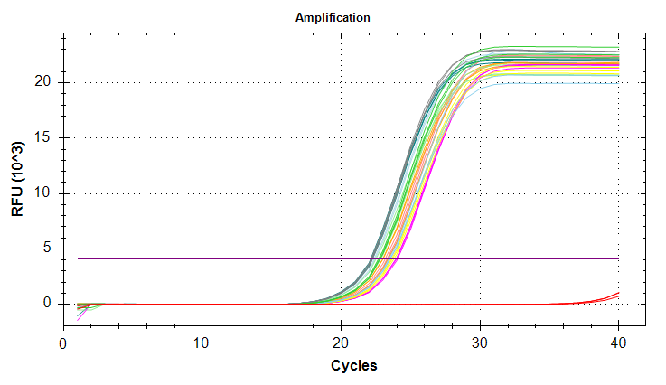
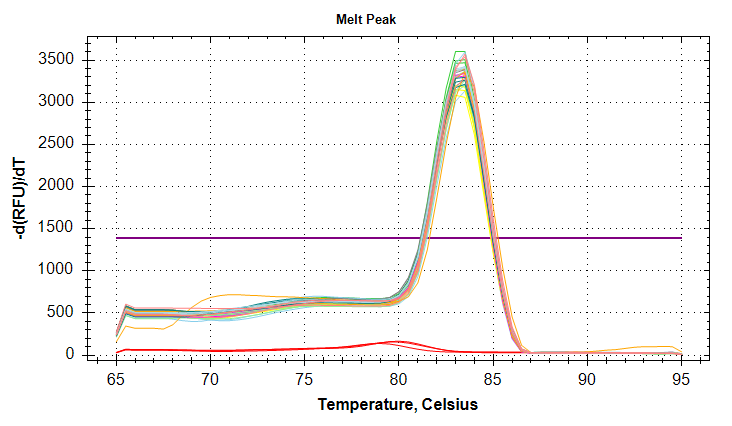
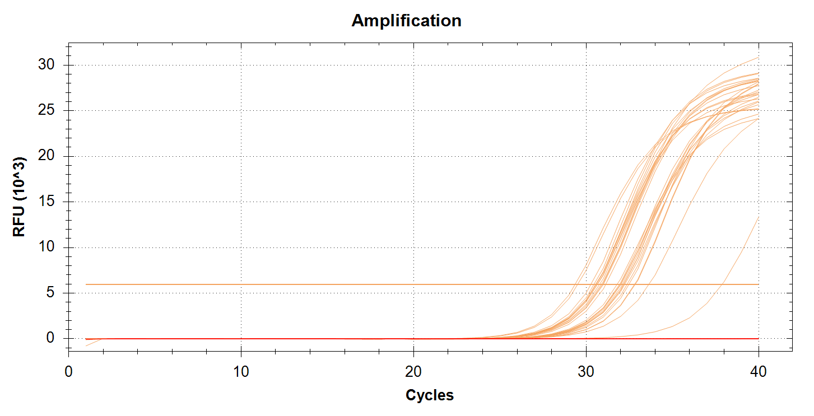
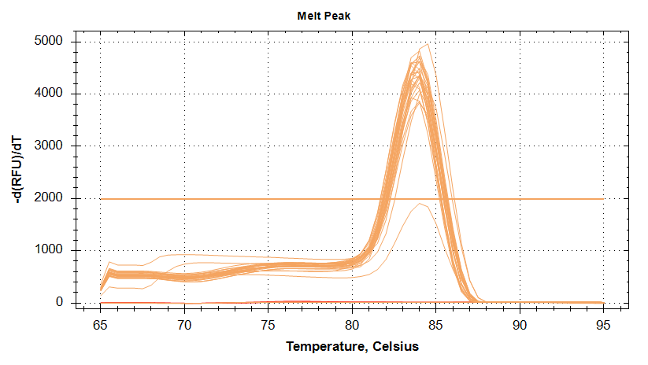
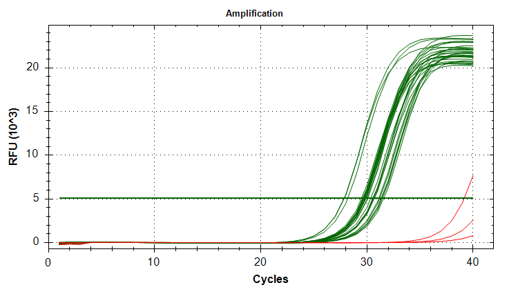
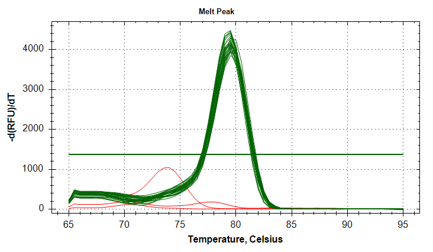
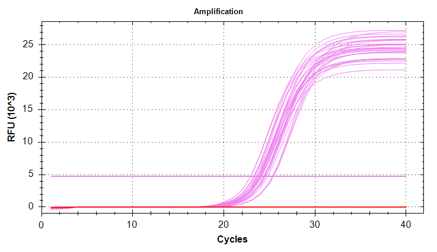
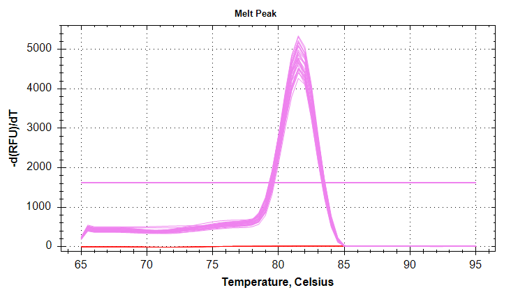
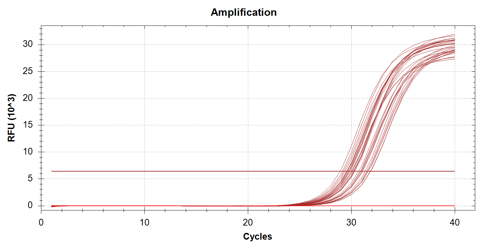
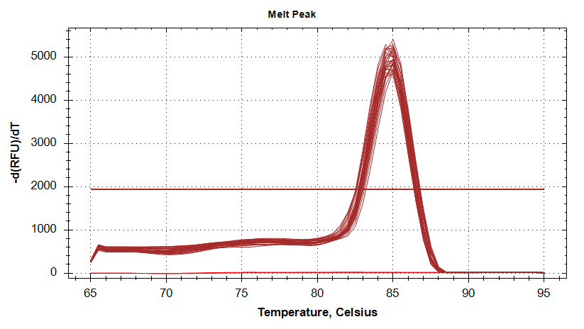

# INTRO

Due to discrepancies in samples sizes used for analysis for some of the genes, I ran qPCRs on the PolyIC Control (`*PC`) samples (`A1PC` - `A5PC`, `B1PC` - `B5PC`) for the following genes: GAPDH, DNMT1, cGAS, HSP90, and VIPERIN. Other than GAPDH, these samples had _not_ been run previously. This was due to the fact that this project stemmed from work performed by Valentina and me. Valentina did not run these genes originally. However, I _did_ run them using my cDNA because these were just the typical suite of stress response genes we were consistently evaluating at the time. I did not realize Valentina had only looked a few genes.

GAPDH on the other hand, _had_ been run by either Valentina and/or Akriti. However, there appeared to be a potential batch effect, as well as a potential treatment effect. This was a concern because GAPDH had been used as the normalizing gene.

So, the goal of this round of qPCRs was to equalize sample sizes across all genes for the poly:IC control samples, and try to remove a potential batch effect in GAPDH.

::: {.callout-note}
These samples are Valentina's cDNA from 8/12/2025.
:::

Previous qPCRs for this project:

- [2026-01-27-qPCRs - M.gigas Valentina PolyIC cGAS, citrate_synthase, and DNMT1](../2026-01-27-qPCRs---M.gigas-Valentina-PolyIC-cGAS-citrate_synthase-and-DNMT1/)

- [2026-01-28-qPCRs - M.gigas Valentina PolyIC ATP synthase, GAPDH, HSP70, and HSP90](../2026-01-28-qPCRs---M.gigas-Valentina-PolyIC-ATP-synthase-GAPDH-HSP70-and-HSP90/)

- [2026-01-29-qPCR - M.gigas Valentina PolyIC VIPERIN](../2026-01-29-qPCR---M.gigas-Valentina-PolyIC-VIPERIN/)

::: {.callout-important}

This notebook does _not_ have any analysis. This will be performed later.

The analysis is available in the [polyIC-larvae GitHub repo](https://github.com/RobertsLab/polyIC-larvae/tree/main):

- [01.00-polyIC-qPCR-analysis.md](https://github.com/RobertsLab/polyIC-larvae/blob/main/scripts/qPCR/01.00-polyIC-qPCR-analysis.md)

:::

 

# MATERIALS & METHODS

## qPCR Setup

### Primers

The following primer sets were run:

| SR ID | Primer Name          |
|-------|----------------------|
| 1172  | Cg_GAPDH_205_F       |
| 1173  | Cg_GAPDH_355_R       |
| 1510  | Cg_DNMT1_F           |
| 1511  | Cg_DNMT1_R           |
| 1827  | Cg_cGAS_F            |
| 1826  | Cg_cGAS_R            |
| 1532  | Cg_Hsp90_F           |
| 1533  | Cg_Hsp90_R           |
| 1829  | Cg_VIPERIN_F         |
| 1828  | Cg_VIPERIN_R         |

### Master mix

All samples were run in triplicate, on low-profile, white 96-well plates (USA Scientific) sealed with TemPlate TR Select Optical Film (USA Scientific) in a CFX Connect (Bio-Rad) or CFX96 (Bio-Rad) real-time thermalcycler. All reactions consisted of the following:

| Component                                          | Stock Concentration | Volume (uL) |
|----------------------------------------------------|---------------------|-------------|
| cDNA                                               | NA                  | 1           |
| SsoAdvanced Universal SYBR Green Supermix (BioRad) | 2x                  | 10          |
| PF                                      | 10uM                | 0.5         |
| PR                                      | 10uM                | 0.5         |
| H2O                                     | NA                  | 8           |
| TOTAL                                              |                     | 20          |

Each primer set's master mix included no template controls (NTCs). Plates were set up as follows:

| Plate | Instrument  | Genes          |
|-------|-------------|----------------|
| 01    | CFX Connect | VIPERIN, DNMT1 |
| 02    | CFX96       | HSP90, cGAS    |
| 03    | CFX Connect | GAPDH          |

For cycling parameters, plate layouts, etc. see the qPCR reports in [RESULTS](#results) section below.

### Software Settings

After running, and before data export, CFX Maestro was used to label all wells with their Target (i.e. gene) and sample names in the Bio-Rad `.pcrd` qPCR file.

::: {.callout-important}

If a plate contained multiple primer sets, `Analsyis Mode...` was set to `Target` to ensure that the auto-baseline threshold was set properly. This is opposed to the default setting, `Fluorophore`, which takes _all_ wells into account when setting the baseline threshold. We want each primer set evaluated independently, since each primer set will behave slightly differently than each other.

:::
 

# RESULTS

## Summary

All amp and melt plots look good (i.e. strong amplification, no amplification in NTCs, single peaks in melt curves)

- [`GAPDH`](#gapdh): [Amplification and melt plots](#plots@fig-GAPDH).

- [`DNMT1`](#dnmt1): [Amplification and melt plots](#plots@fig-DNMT1).

- [`cGAS`](#cgas): [Amplification and melt plots](#plots@fig-cGAS).

- [`HSP90`](#hsp90): [Amplification and melt plots](#plots@fig-HSP90).

- [`VIPERIN`](#viperin): [Amplification and melt plots](#plots@fig-VIPERIN).

## Files

::: {.callout-tip}

- `report-*.pdf`: qPCR Reports. Contains plate layouts, cycling params, amp/melt plots, etc.

- `*Cq_Results.csv`: Cycle quantity (Cq) data.

- `*.pcrd`: Source qPCR data file. Requires CFX Maestro (Bio-Rad) software to open. Genes run on the same plate share a single `.pcrd` file.

:::

---

### GAPDH

##### Cq Data

- [sam_2026-10-08_10-20-43_Connect-GAPDH-Quantification-Cq_Results.csv](./sam_2026-10-08_10-20-43_Connect-GAPDH-Quantification-Cq_Results.csv)

##### Report

- [report-sam_2026-10-08_10-20-43_Connect-GAPDH.pdf](./report-sam_2026-10-08_10-20-43_Connect-GAPDH.pdf)

##### CFX File

- [sam_2026-10-08_10-20-43_Connect-GAPDH.pcrd](./sam_2026-10-08_10-20-43_Connect-GAPDH.pcrd)

---

### DNMT1

##### Cq Data

- [sam_2026-10-08_09-19-38_Connect-DNMT1-Quantification-Cq_Results.csv](./sam_2026-10-08_09-19-38_Connect-DNMT1-Quantification-Cq_Results.csv)

##### Report

- [report-sam_2026-10-08_09-19-38_Connect-DNMT1.pdf](./report-sam_2026-10-08_09-19-38_Connect-DNMT1.pdf)

##### CFX File

- [sam_2026-10-08_09-19-38_Connect-VIPERIN-DNMT1.pcrd](./sam_2026-10-08_09-19-38_Connect-VIPERIN-DNMT1.pcrd)

---

### cGAS

##### Cq Data

- [sam_2026-10-08_09-37-12_CFX96-cGAS-Quantification-Cq_Results.csv](./sam_2026-10-08_09-37-12_CFX96-cGAS-Quantification-Cq_Results.csv)

##### Report

- [report-sam_2026-10-08_09-37-12_CFX96-cGAS.pdf](./report-sam_2026-10-08_09-37-12_CFX96-cGAS.pdf)

##### CFX File

- [sam_2026-10-08_09-37-12_CFX96-HSP90-cGAS.pcrd](./sam_2026-10-08_09-37-12_CFX96-HSP90-cGAS.pcrd)

---

### HSP90

##### Cq Data

- [sam_2026-10-08_09-37-12_CFX96-HSP90-Quantification-Cq_Results.csv](./sam_2026-10-08_09-37-12_CFX96-HSP90-Quantification-Cq_Results.csv)

##### Report

- [report-sam_2026-10-08_09-37-12_CFX96-HSP90.pdf](./report-sam_2026-10-08_09-37-12_CFX96-HSP90.pdf)

##### CFX File

- [sam_2026-10-08_09-37-12_CFX96-HSP90-cGAS.pcrd](./sam_2026-10-08_09-37-12_CFX96-HSP90-cGAS.pcrd)

---

### VIPERIN

##### Cq Data

- [sam_2026-10-08_09-19-38_Connect-VIPERIN-Quantification-Cq_Results.csv](./sam_2026-10-08_09-19-38_Connect-VIPERIN-Quantification-Cq_Results.csv)

##### Report

- [report-sam_2026-10-08_09-19-38_Connect-VIPERIN.pdf](./report-sam_2026-10-08_09-19-38_Connect-VIPERIN.pdf)

##### CFX File

- [sam_2026-10-08_09-19-38_Connect-VIPERIN-DNMT1.pcrd](./sam_2026-10-08_09-19-38_Connect-VIPERIN-DNMT1.pcrd)

---

## Plots

<!-- TODO: Add amp/melt plot images. -->

::: {#fig-GAPDH layout-ncol=2}

{#fig-GAPDH_amp}

{#fig-GAPDH_melt}

GAPDH qPCR plots.
:::

---

::: {#fig-DNMT1 layout-ncol=2}

{#fig-DNMT1_amp}

{#fig-DNMT1_melt}

DNMT1 qPCR plots.
:::

---

::: {#fig-cGAS layout-ncol=2}

{#fig-cGAS_amp}

{#fig-cGAS_melt}

cGAS qPCR plots.
:::

---

::: {#fig-HSP90 layout-ncol=2}

{#fig-HSP90_amp}

{#fig-HSP90_melt}

HSP90 qPCR plots.
:::

---

::: {#fig-VIPERIN layout-ncol=2}

{#fig-VIPERIN_amp}

{#fig-VIPERIN_melt}

VIPERIN qPCR plots.
:::
