# INTRO

Tested 13 new Manila clam (_R.philippinarum_) primer sets to see if they amplify and if they are template-specific. Primer sets target the following genes:

- C1qL3
- eIF4A3
- HPRT
- HSF1
- IAP
- RPS14
- Viperin

cDNA was the pooled gill cDNA I made [earlier today (20261028)](../2026-10-28-Reverse-Transcription---R.philippinarum-Pooled-Gill-RNA-from-20261027/index.qmd).

::: {.callout-note}
No analysis was performed. This was only to assess primer success/specificity.
:::

# MATERIALS & METHODS

## Primers

| SR_ID | PrimerName      |
|-------|-----------------|
| 1875  | Rp-HSF1-827     |
| 1874  | Rp-HSF1-927     |
| 1873  | Rp-HSF1-164     |
| 1872  | Rp-HSF1-291     |
| 1871  | Rp-Viperin-5068 |
| 1870  | Rp-Viperin-5197 |
| 1869  | Rp-Viperin-929  |
| 1868  | Rp-Viperin-1050 |
| 1867  | Rp-IAP-1424     |
| 1866  | Rp-IAP-1559     |
| 1865  | Rp-IAP-45       |
| 1864  | Rp-IAP-195      |
| 1863  | Rp-C1qL3-518    |
| 1862  | Rp-C1qL3-660    |
| 1861  | Rp-C1qL3-206    |
| 1860  | Rp-C1qL3-325    |
| 1859  | Rp-eIF4A3-2653  |
| 1858  | Rp-eIF4A3-2830  |
| 1857  | Rp-eIF4A3-1144  |
| 1856  | Rp-eIF4A3-1320  |
| 1855  | Rp-RPS14-406    |
| 1854  | Rp-RPS14-527    |
| 1853  | Rp-RPS14-11     |
| 1852  | Rp-RPS14-186    |
| 1851  | Rp-HPRT-608     |
| 1850  | Rp-HPRT-728     |

## Reactions

All samples and no template controls (NTCs) were run in triplicate, on low-profile, white 96-well plates (USA Scientific) sealed with TemPlate TR Select Optical Film (USA Scientific) in a CFX Connect (Bio-Rad) real-time thermalcycler. All reactions consisted of the following:

| Component                                          | Stock Concentration | Volume (uL) |
|----------------------------------------------------|---------------------|-------------|
| cDNA                                               | NA                  | 1           |
| SsoAdvanced Universal SYBR Green Supermix (BioRad) | 2x                  | 10          |
| PF                                      | 10uM                | 0.5         |
| PR                                      | 10uM                | 0.5         |
| H2O                                     | NA                  | 8           |
| TOTAL                                              |                     | 20          |

For cycling parameters, plate layouts, etc. see the qPCR report in the [RESULTS](#results) section below.

::: {.callout-important}
`Analysis Mode...` was set to `Target` so that the auto-baseline threshold was set for each primer set independently.
:::

# RESULTS

## Summary

Of the 13 primer sets, 9 produced amplification and 4 produced none. Every primer set that amplified produced a single melt peak in the template wells.

| SR IDs | Gene    | Mean Cq | Cq SD | NTCs                                 | Result                       |
|--------|---------|---------|-------|--------------------------------------|------------------------------|
| 1850/1 | HPRT    | N/A     | N/A   | Clean                                | No amplification             |
| 1852/3 | RPS14   | 35.61   | 0.282 | Clean                                | Late amplification           |
| 1854/5 | RPS14   | 18.61   | 0.077 | **Amplified (Cq 19.12); primer dimer** | Works, but primer dimer      |
| 1856/7 | eIF4A3  | 29.72   | 0.160 | Clean                                | Works                        |
| 1858/9 | eIF4A3  | 27.65   | 0.470 | Clean                                | Works                        |
| 1860/1 | C1qL3   | N/A     | N/A   | Clean                                | No amplification             |
| 1862/3 | C1qL3   | N/A     | N/A   | Clean (no Cq)                        | No amplification             |
| 1864/5 | IAP     | N/A     | N/A   | Clean (no Cq)                        | No amplification             |
| 1866/7 | IAP     | 32.17   | 0.305 | Clean                                | Works                        |
| 1868/9 | Viperin | 35.77   | 0.715 | Clean                                | Late amplification           |
| 1870/1 | Viperin | 27.71   | 0.111 | Clean                                | Works                        |
| 1872/3 | HSF1    | 34.81   | 0.369 | Clean                                | Late amplification           |
| 1874/5 | HSF1    | 29.69   | 0.101 | Clean                                | Works                        |

Working primer sets (good amplification, single melt peak, no NTC amplification):

- eIF4A3: SR IDs 1856/7, 1858/9
- IAP: SR IDs 1866/7
- Viperin: SR IDs 1870/1
- HSF1: SR IDs 1874/5

Notes:

- **RPS14 (SR IDs 1854/5)**: Amplifies early (Cq ~18.6), which is expected for a ribosomal protein gene. The NTCs also amplified (Cq ~19.1), but their melt peak is ~69oC, compared to ~83oC in the template wells. So the NTC signal is primer dimer, not contamination. The template wells show only the ~83oC peak, but NTC Cqs this close to the template Cqs make this primer set questionable for quantification.

- **Late amplifiers (SR IDs 1852/3, 1868/9, 1872/3)**: Cqs of ~35-36, each with a single melt peak and clean NTCs. These amplify, but they're not useful when there's a better primer set for the same gene. RPS14 SR IDs 1852/3 coming up at Cq ~35.6 (vs. ~18.6 for the other RPS14 set) suggests these primers are pretty inefficient. SR IDs 1868/9 were flagged by CFX Maestro for replicate SD > 0.5.

- **No amplification (SR IDs 1850/1, 1860/1, 1862/3, 1864/5)**: HPRT (only one set tested) and both C1qL3 sets failed. One NTC in each of SR IDs 1862/3 and 1864/5 shows a small melt peak, but no Cq was called for either.

By gene:

| Gene    | Status                                                  |
|---------|---------------------------------------------------------|
| eIF4A3  | Two working sets                                        |
| HSF1    | One working set (1874/5)                                |
| IAP     | One working set (1866/7)                                |
| Viperin | One working set (1870/1)                                |
| RPS14   | One set amplifies, but with primer dimer in NTCs (1854/5) |
| HPRT    | No working set                                          |
| C1qL3   | No working set                                          |

## Files

::: {.callout-tip}

- `*.pdf`: qPCR report. Contains plate layout, cycling params, Cq values, QC flags.

- `*.pcrd`: Source qPCR data file. Requires CFX Maestro (Bio-Rad) software to open.

:::

- [sam_2026-10-28_10-29-21_Connect-rphi_primer_tests.pdf](./sam_2026-10-28_10-29-21_Connect-rphi_primer_tests.pdf)

- [sam_2026-10-28_10-29-21_Connect-rphi_primer_tests.pcrd](./sam_2026-10-28_10-29-21_Connect-rphi_primer_tests.pcrd)

## Plots

---

::: {#fig-SRID-1850-1 layout-ncol=2}

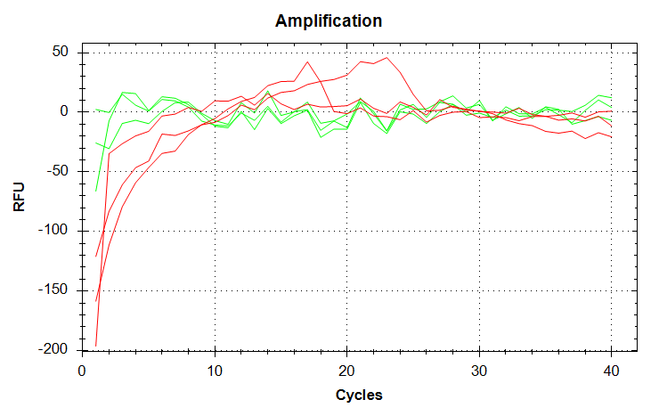{#fig-SRID-1850-1_amp .lightbox}

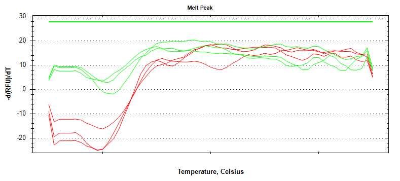{#fig-SRID-1850-1_melt .lightbox}

SR IDs 1850/1 (HPRT; Rp-HPRT-728 / Rp-HPRT-608) qPCR plots. NTCs are shown in red.
:::

---

::: {#fig-SRID-1852-3 layout-ncol=2}

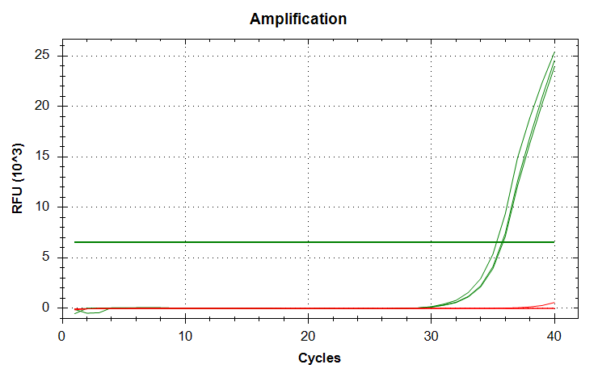{#fig-SRID-1852-3_amp .lightbox}

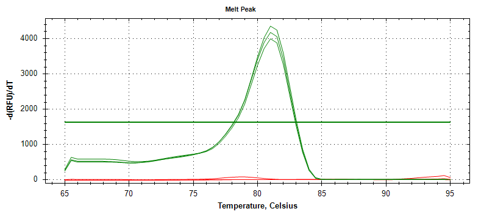{#fig-SRID-1852-3_melt .lightbox}

SR IDs 1852/3 (RPS14; Rp-RPS14-186 / Rp-RPS14-11) qPCR plots. NTCs are shown in red.
:::

---

::: {#fig-SRID-1854-5 layout-ncol=2}

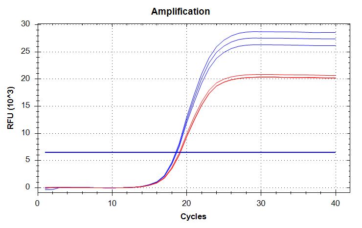{#fig-SRID-1854-5_amp .lightbox}

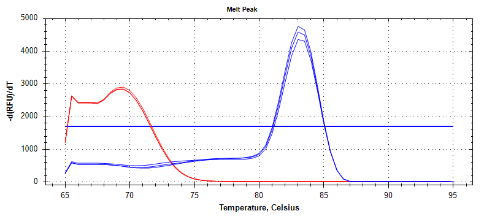{#fig-SRID-1854-5_melt .lightbox}

SR IDs 1854/5 (RPS14; Rp-RPS14-527 / Rp-RPS14-406) qPCR plots. NTCs are shown in red.
:::

---

::: {#fig-SRID-1856-7 layout-ncol=2}

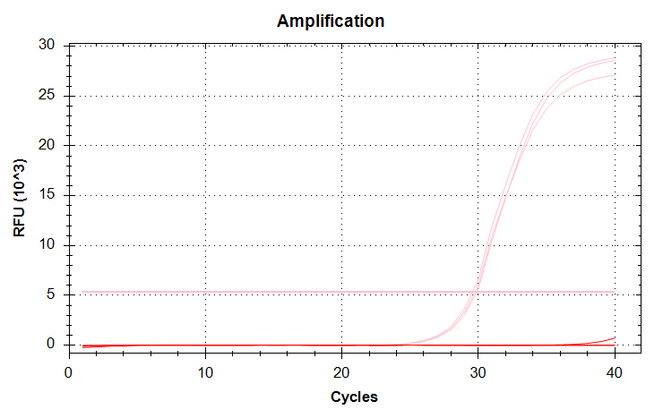{#fig-SRID-1856-7_amp .lightbox}

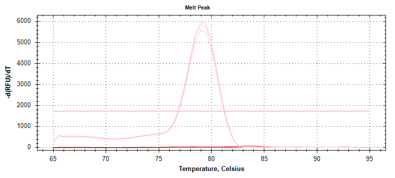{#fig-SRID-1856-7_melt .lightbox}

SR IDs 1856/7 (eIF4A3; Rp-eIF4A3-1320 / Rp-eIF4A3-1144) qPCR plots. NTCs are shown in red.
:::

---

::: {#fig-SRID-1858-9 layout-ncol=2}

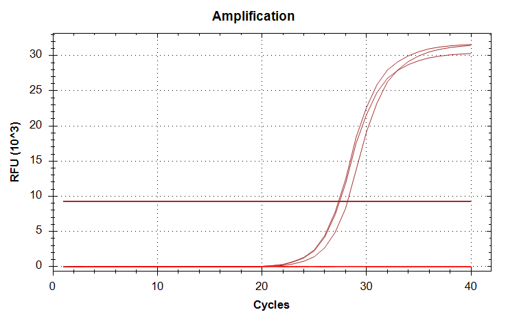{#fig-SRID-1858-9_amp .lightbox}

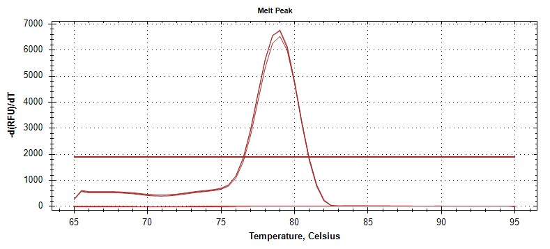{#fig-SRID-1858-9_melt .lightbox}

SR IDs 1858/9 (eIF4A3; Rp-eIF4A3-2830 / Rp-eIF4A3-2653) qPCR plots. NTCs are shown in red.
:::

---

::: {#fig-SRID-1860-1 layout-ncol=2}

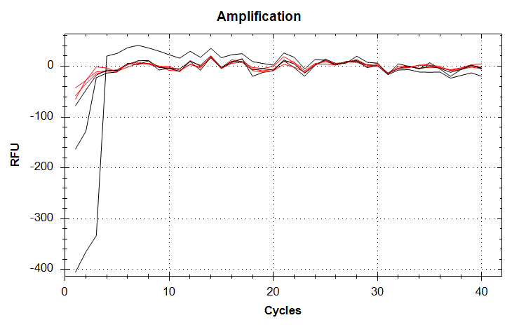{#fig-SRID-1860-1_amp .lightbox}

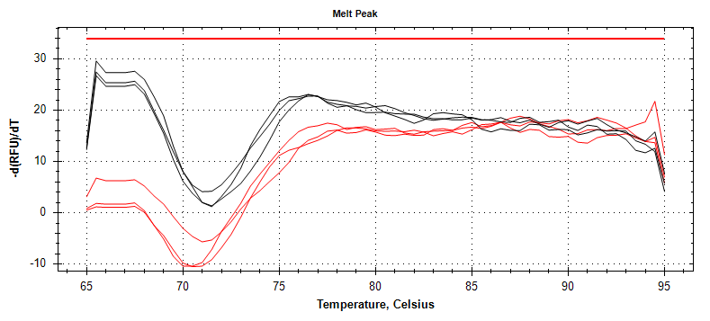{#fig-SRID-1860-1_melt .lightbox}

SR IDs 1860/1 (C1qL3; Rp-C1qL3-325 / Rp-C1qL3-206) qPCR plots. NTCs are shown in red.
:::

---

::: {#fig-SRID-1862-3 layout-ncol=2}

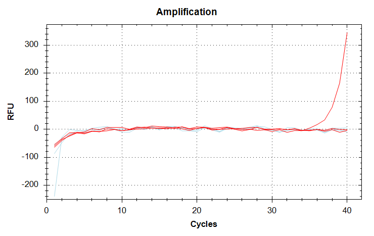{#fig-SRID-1862-3_amp .lightbox}

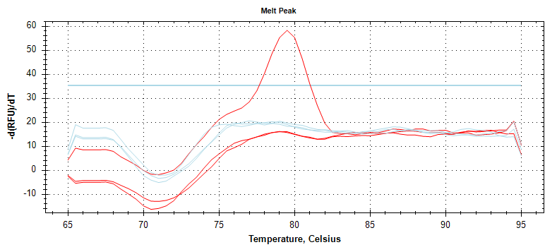{#fig-SRID-1862-3_melt .lightbox}

SR IDs 1862/3 (C1qL3; Rp-C1qL3-660 / Rp-C1qL3-518) qPCR plots. NTCs are shown in red.
:::

---

::: {#fig-SRID-1864-5 layout-ncol=2}

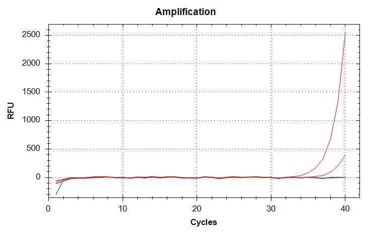{#fig-SRID-1864-5_amp .lightbox}

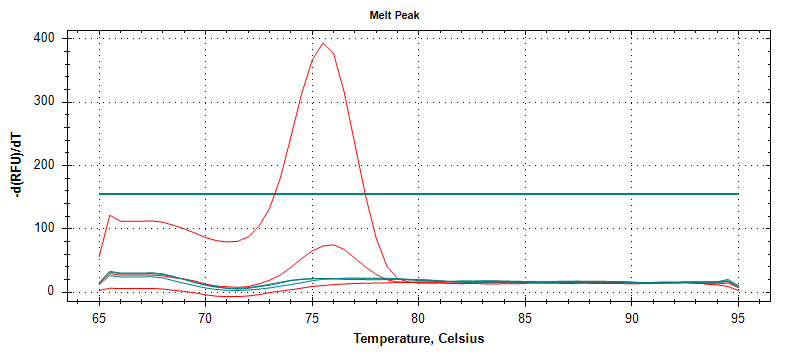{#fig-SRID-1864-5_melt .lightbox}

SR IDs 1864/5 (IAP; Rp-IAP-195 / Rp-IAP-45) qPCR plots. NTCs are shown in red.
:::

---

::: {#fig-SRID-1866-7 layout-ncol=2}

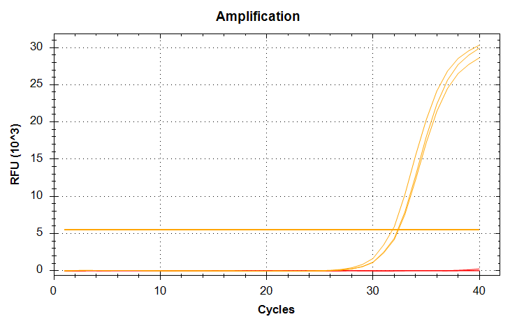{#fig-SRID-1866-7_amp .lightbox}

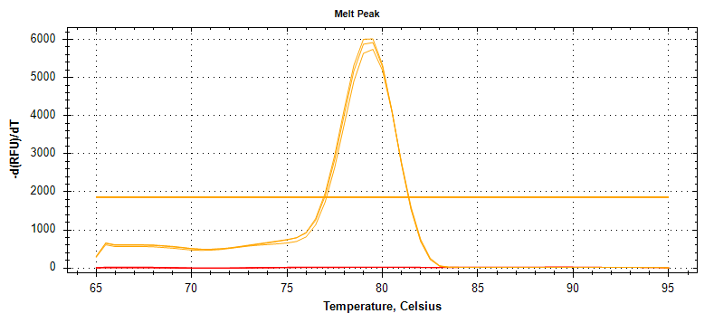{#fig-SRID-1866-7_melt .lightbox}

SR IDs 1866/7 (IAP; Rp-IAP-1559 / Rp-IAP-1424) qPCR plots. NTCs are shown in red.
:::

---

::: {#fig-SRID-1868-9 layout-ncol=2}

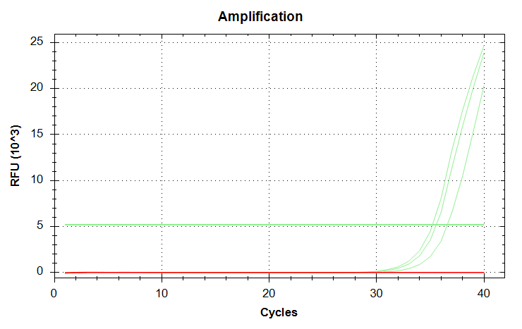{#fig-SRID-1868-9_amp .lightbox}

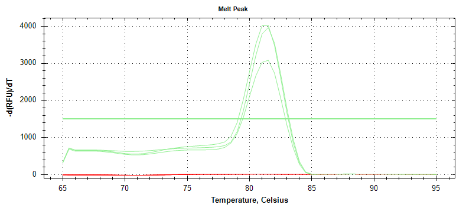{#fig-SRID-1868-9_melt .lightbox}

SR IDs 1868/9 (Viperin; Rp-Viperin-1050 / Rp-Viperin-929) qPCR plots. NTCs are shown in red.
:::

---

::: {#fig-SRID-1870-1 layout-ncol=2}

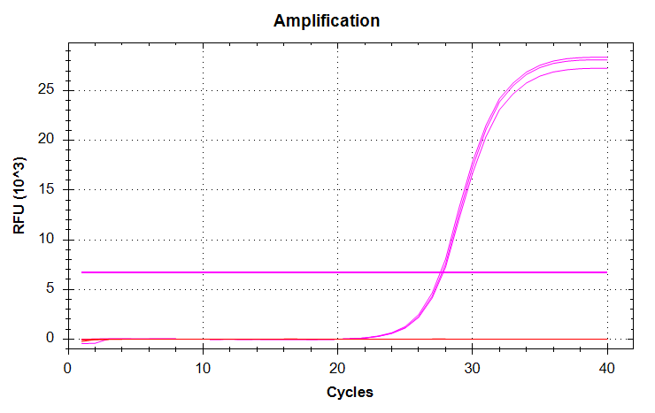{#fig-SRID-1870-1_amp .lightbox}

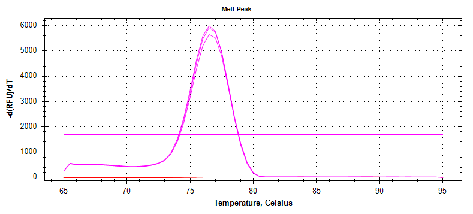{#fig-SRID-1870-1_melt .lightbox}

SR IDs 1870/1 (Viperin; Rp-Viperin-5197 / Rp-Viperin-5068) qPCR plots. NTCs are shown in red.
:::

---

::: {#fig-SRID-1872-3 layout-ncol=2}

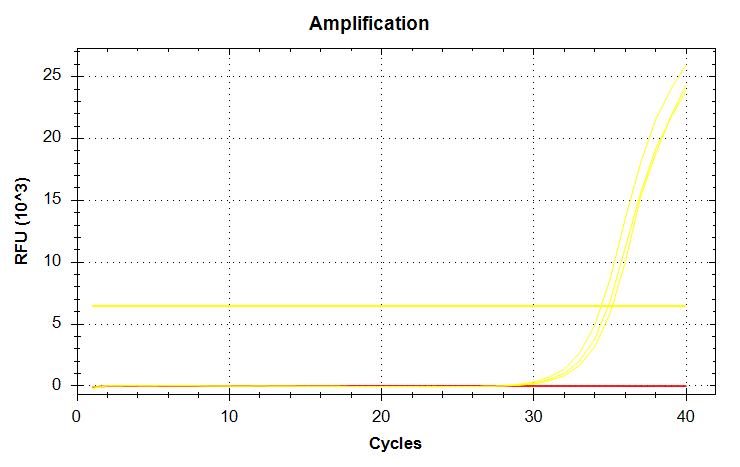{#fig-SRID-1872-3_amp .lightbox}

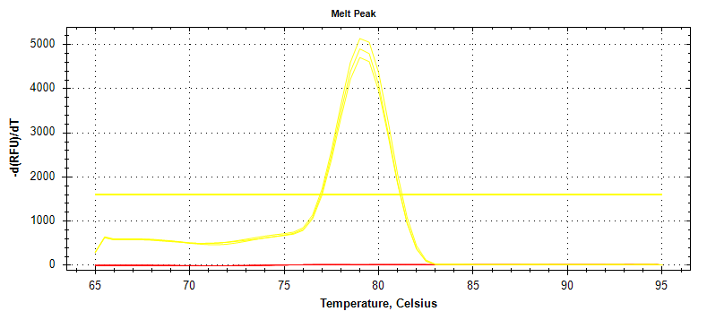{#fig-SRID-1872-3_melt .lightbox}

SR IDs 1872/3 (HSF1; Rp-HSF1-291 / Rp-HSF1-164) qPCR plots. NTCs are shown in red.
:::

---

::: {#fig-SRID-1874-5 layout-ncol=2}

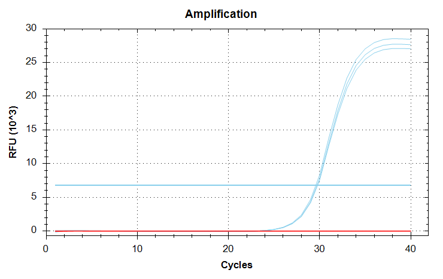{#fig-SRID-1874-5_amp .lightbox}

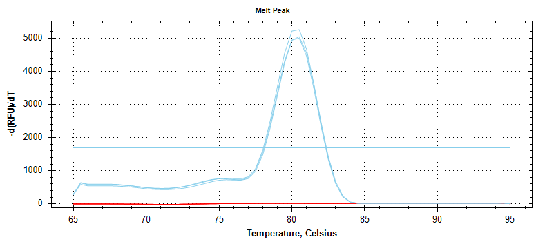{#fig-SRID-1874-5_melt .lightbox}

SR IDs 1874/5 (HSF1; Rp-HSF1-927 / Rp-HSF1-827) qPCR plots. NTCs are shown in red.
:::
